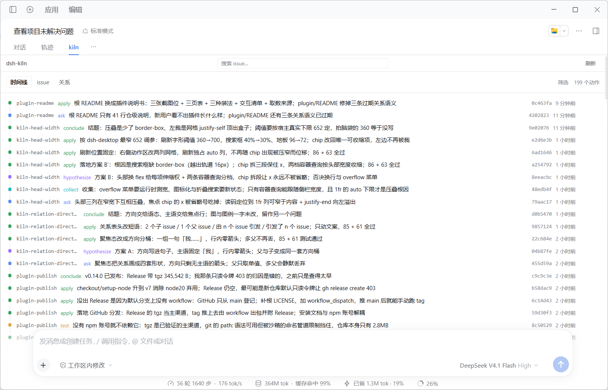
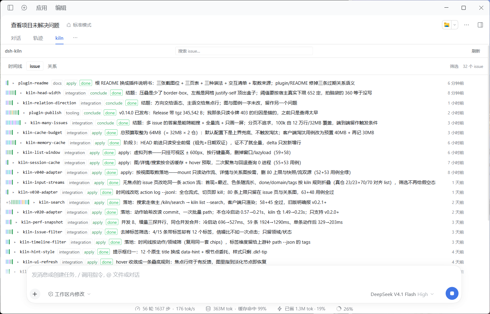
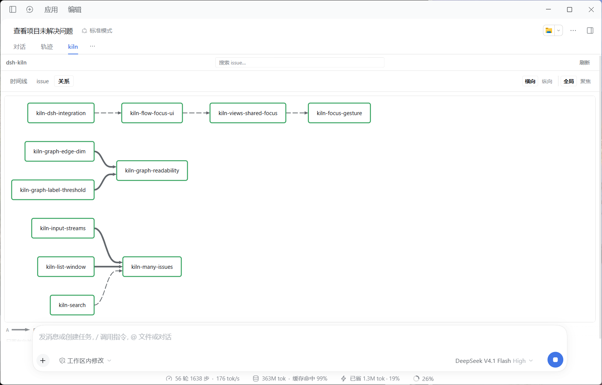

# dsh-kiln

把 [kiln](https://github.com/jackiehank/kiln) 的 issue 历史搬进 DSH（DeepSeek Harness）的插件。

kiln 用 git commit 的 trailer（`issue:` + `action:`）记录「问题 → 动作 → 结论」，于是「为什么这么做」
只存在于提交历史里。这个插件把它读成**能点的三页界面**——时间线、issue、关系，三页共享一个焦点 issue。

**只读**：不写 trailer、不造提交、不装 git 钩子、不落盘；数据全部来自 `kiln` 子进程的输出。

**时间线**——全仓动作流，一行一个动作



**issue**——一行一个 issue；左侧色条是它的动作序列，聚焦后读出父子、阻塞、因果、取代与弱关联



**关系**——关系图，可切全局 / 聚焦与横向 / 纵向



## 三页

| 页 | 看什么 |
| --- | --- |
| **时间线** | 全仓动作流，一行一个动作：issue、动作名、标题、多久以前。点开看这条提交的 sha / 领域 / 标签 / 时间。按**动作**和**领域**筛。 |
| **issue** | 一行一个 issue（首现 = 最近一次动作，左侧色条是它的动作序列，末尾 `done` 表示有新提交也停在终点动作）。点开看它的动作链；聚焦后读出**结构**：`N 个父 issue` / `N 个子 issue` / `阻塞了 N 个 issue` / `被 N 个 issue 阻塞` / `取代了…` / `被…取代` / `由 N 个 issue 引发` / `引发了 N 个 issue` / `N 个弱关联（无方向）`。按**领域**和**状态**筛。 |
| **关系** | 关系图。工具栏三段：横向 / 纵向、全局 / 聚焦（1 或 2 跳）。线的粗细是结构强弱，虚线是因果与取代，锚点是弱关联；hover 节点显示这条 issue 的 ask 标题，图例一句一句写着「A 是 B 的一部分」「A 引发 B」。 |

## 安装

要求：**DSH 0.2.x**、**kiln v0.3.0+**（`go install github.com/jackiehank/kiln/cmd/kiln@latest`）。
装进哪个 profile，就把下面的 `web` 换成它（桌面端通常是 `desktop`）。

**GitHub Release 的 tgz（推荐：一次下载、可离线保存）**

1. 到 <https://github.com/jackiehank/dsh-kiln/releases> 下载 `jackiehank-dsh-kiln-<版本>.tgz`；
2. 装进 profile：

```powershell
dsh plugin --profile web add ./jackiehank-dsh-kiln-0.15.1.tgz
```

**从 GitHub 直接装**（也是 DSH「安装插件」界面的做法：粘仓库地址）

```powershell
dsh plugin --profile web add github:jackiehank/dsh-kiln
```

仓库根有一个 `private` 的转发 manifest（`exports` / `dsh.bundle.patch` 全指向 `plugin/`），所以
`github:owner/repo` 装出来就是真包。代价是**整仓打包**（约 2MB，含 docs/）。只想装子目录、少下点东西：

```powershell
dsh plugin --profile web add github:jackiehank/dsh-kiln#path:/plugin
```

**本地 checkout**（改这个插件时用）

```powershell
dsh plugin --profile web add <本仓库>/plugin
```

装完刷新 GUI（或重启 DSH），标签排里会多一个 `kiln`；在 kiln 仓库里打开会话就能看到视图。
npm 包还没发布（见 [`plugin-publish`](docs/issues/plugin-publish.md)），有账号后会多一条
`dsh plugin --profile web add @jackiehank/dsh-kiln`。

## 用起来

- **焦点**是全局的：三页共享同一个 issue。行尾 `⌖ 聚焦` 或按 `f` 聚焦光标所在行，`Esc` 或点页头的
  `焦点：<id> ×` 退出。焦点只存在内存里，切页不丢、刷新即清。
- **搜索**：第一层页头中间常驻输入框，停 120ms 后查全仓（不看筛选与焦点）；`↑↓` 选、`⏎` 打开、
  `Esc` 清空。命中 issue 名 → issue 页；命中动作标题 → 时间线并展开滚到那条动作。
- **筛选**：纯客户端，同组多选是「或」、组间是「与」；某个维度在本仓没有可选项时整组不出现。
- **刷新**：重新读动作流、关系图与详情（缓存清空）。
- 页头会跟着侧栏宽度收缩：先省略焦点 chip 的 id（`×` 永远在），再收窄仓库名、去掉「焦点：」前缀，
  最后把「刷新」降成一个 `↻` 字形。
- 悬停任何元素都有说明（`data-hint`），包括色条、计数、图例。

## 数据从哪来

**一个视图一条 kiln 命令**，不在插件里复刻 kiln 的状态解析，也不自建第二份状态：

| 视图 | 命令 |
| --- | --- |
| 时间线 | `kiln action log --jsonl`（按行流式） |
| issue 列表 | 同一条动作流，客户端折叠 |
| 详情 / 聚焦 | `kiln path <id> --json`（动作 + 进出这个 issue 的全部边） |
| 关系图 | `kiln graph --json` |
| 搜索 | `kiln list --search <q> --json` |

按需取数：首屏只读动作流，关系图和详情点开才取，图 / 详情 / 搜索在会话内缓存。动作流两端都按 HEAD
缓存——HEAD 没动时切回标签**0 子进程、0 字节**；HEAD 前进时只读能证明安全的前缀。规模、缓存条件、
行的形状、失败文案这些细节都在 [`plugin/README.md`](plugin/README.md)。

## 已知边界

- 只读；不写 issue、不提交。
- 规模上界是整条动作流：10 万动作约 24MB，默认预算 12 万行 / 32MB；上游明确不做分页。
- 列表是虚拟化的：find-in-page 只覆盖「可视区 ± 600px」的行。
- 详情按需，点开多等约 40ms（冷读 120ms），换来没有条数上限。
- 关系语义来自 kiln 的词表：`part-of` / `blocks` / `supersedes` / `caused-by` / `relates-to`；
  词表里出现新关系时，缺的是一句文案，不是新分支。

更多见 [`plugin/README.md`](plugin/README.md#已知边界)。

## 开发

```text
plugin/              DSH 插件本体（Host 半 lib/index.js + 浏览器半 lib/client.js）
package.json         仓库根的转发 manifest：private，exports / dsh.bundle 全指向 plugin/
plugin/test/         宿主两侧用例：run.mjs（纯函数 / 缓存决策）＋ render.mjs（渲染冒烟）
docs/issues/         一条 issue 一个 Markdown：问题、证据、结论、落地位置
docs/screenshots/    README 的三张截图
AGENTS.md            agent 工作约定，先读这个
.kilnconfig.jsonc    kiln 配置：动作词表 / VCS / worktree
```

```powershell
npm test --prefix plugin     # 86 宿主用例 + 63 渲染用例
```

**这个仓库自己就用 kiln 管 issue**——插件展示的就是它自己的历史：每个动作是一次带 trailer 的提交，
没有数据库也没有索引。插件为什么长这样（为什么是一个 profile bundle、为什么严格只读）写在
[`docs/issues/kiln-dsh-integration.md`](docs/issues/kiln-dsh-integration.md)。

```powershell
kiln status          # 全库概览
kiln path <issue>    # 某条 issue 的研究路径
kiln check           # 语义完整性
```

流程与踩坑在 [`AGENTS.md`](AGENTS.md)。

## 许可

[MIT](LICENSE)
