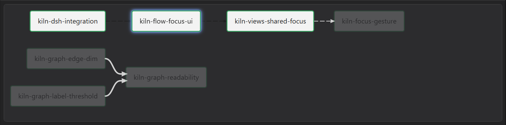
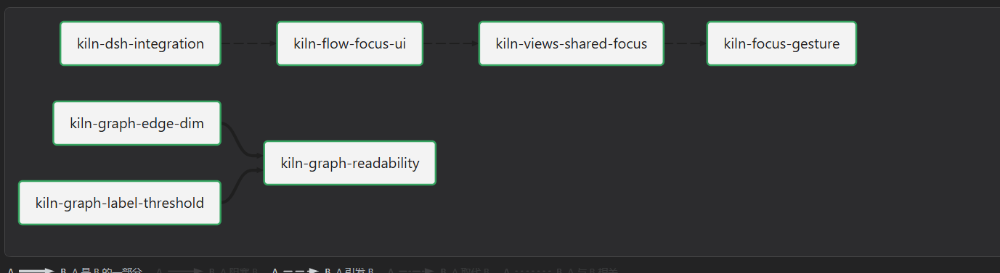

# kiln-graph-dark-theme — 关系图在深色主题下的配色

## 问题

深色主题下，关系图不是"颜色淡一点"，而是**主次颠倒**：

1. **正常边几乎看不见**：边 `#1f1f1f` 落在画布 `#2c2c2e` 上（对比度 ≈ 1.2:1），
   全局视图只剩一堆白框，看不出谁连着谁。
2. **淡化反而更亮**：淡化色是"20% 前景 + 80% 白底"混出来的 `#d2d2d2`，
   在深色画布上是全图最亮的线——该退的线变成了主角。
3. **节点是浅色贴纸**：节点填充 `#f3f3f3` + 深色字，在深色画布上一块块发亮，
   和旁边的列表页完全不是一套材质。

## 根因方向（collect 里坐实）

图不是我们画的，是 `plugin/lib/client.pele.js`（Pele 1.10）画的。它在 `<svg>` 上声明了一套
主题变量并直接写默认值（`--_bg: var(--pele-bg, #fff)` 这种），而我们**从来没有给 `--pele-*` 赋值**，
所以不管 DSH 是浅色还是深色，图永远按"白底深字"渲染；我们的淡化公式又拿这套浅色默认值去混，
于是深色下越混越亮。

## 目标

让图跟着宿主主题走，且只有一处出口：

- 把 Pele 暴露的主题变量映射到我们已有的 `--dkf-*` 角色（它们本来就指着宿主 `--dsw-*` 语义 token）；
- 淡化色改成"向画布混"，而不是"向前景/白底混"；
- 深色下正常边要看得见，淡化边要明显弱于正常边（顺序不能反）。

## 边界

- 只改 `.dkf-graph` 上的变量映射与淡化的混色目标，不动布局、不动线型阶梯、不动交互。
- 不覆盖节点描边：`classDef act_<action> stroke:<动作色>` 是关系图里唯一的动作语义，保持原样。
- 不引入第二套颜色常量：所有值必须落回 `--dkf-*` / `--dsw-*`。

## 验收

- 深色下正常边的颜色与画布的对比度足够（≥ 3:1），且淡化边更接近画布（不再比正常边亮）。
- 浅色主题的观感不变（边仍是最深的一条，节点仍是白底深字）。
- `.dkf-graph` 之外不出现新的裸色值；`--pele-*` 的映射只写在一个规则里。
- 测试里钉住两条：映射存在、淡化混色目标是画布色而不是白/前景。

## 收集：图是 Pele 画的，颜色也是 Pele 定的





### Pele 的主题钩子（`plugin/lib/client.pele.js` 里的一行字符串）

```js
"--_bg:var(--pele-bg,#fff);--_fg:var(--pele-fg,#1f1f1f);--_m:var(--pele-muted,#6e6e6e);
 --_l:var(--pele-line,#1f1f1f);--_s:var(--pele-surface,#f3f3f3);--_a:var(--pele-surface-alt,#e6e6e6);
 --_b:var(--pele-border,#8a8a8a);--_c:var(--pele-accent,#5b7bd5)"
```

它把 `--pele-*` 转成内部变量 `--_*`，再用在生成的 SVG 上。各变量的落点（在 bundle 里数出来的）：

| Pele 变量 | 默认 | 用在哪 | 证据 |
| --- | --- | --- | --- |
| `--pele-line` | `#1f1f1f` | **所有边**与箭头 | `<g class="pele-edges" stroke="var(--_l)">` |
| `--pele-surface` | `#f3f3f3` | 节点填充 | `fill="var(--_s)"` ×25 |
| `--pele-border` | `#8a8a8a` | 形状描边、缩放控件边框 | `stroke="var(--_b)"` ×78 |
| `--pele-bg` | `#fff` | 边标签底板、控件底 | `fill="var(--_bg)"` ×38 |
| `--pele-fg` | `#1f1f1f` | 节点/标签文字、箭头 | `fill="var(--_fg)"` ×7 |
| `--pele-muted` | `#6e6e6e` | 次级文字 | `var(--_m)` |
| `--pele-surface-alt` | `#e6e6e6` | 交替色块 | `fill="var(--_a)"` ×16 |
| `--pele-accent` | `#5b7bd5` | 强调 | `fill="var(--_c)"` ×3 |

**我们从来没给 `--pele-*` 赋过值**（`client.js` 里 0 处），Pele 自己也不看主题
（bundle 里 `prefers-color-scheme` 0 次、`data-theme` 0 次）。所以无论 DSH 是浅色还是深色，
图永远按默认的"白底深字"渲染——这就是全部根因。

### 从两张截图上取的颜色（不是猜的）

| 位置 | 实测 | 对应 |
| --- | --- | --- |
| 图卡画布 | `#2c2c2e` | 正好等于深色 `--dsw-alias-bg-layer-2`（`neutral-bluish-850`）→ token 本身是对的 |
| 页面底 | `#232324` | `--dsw-alias-bg-layer-1`（`875`） |
| 节点填充 | `#f3f3f3` | Pele `--pele-surface` 的默认值 |
| 正常边 | `#1f1f1f` | Pele `--pele-line` 的默认值 |
| 淡化边 | `#d2d2d2` | 我们算的 `color-mix(20% #1f1f1f, 80% #fff)` = `0.2×31 + 0.8×255 = 210` = `#d2d2d2` |

最后一行是关键：淡化后的颜色与像素值**逐位吻合**，说明"越淡越亮"不是观感问题，是公式拿错了混色终点——
拿白底（`--_bg`）当终点，而不是拿图的画布色当终点。

### 对比度（WCAG 相对亮度）

| | 正常边 | 淡化边 | 结论 |
| --- | --- | --- | --- |
| 深色 · 改前 | 1.18:1（`#1f1f1f` on `#2c2c2e`） | 9.22:1（`#d2d2d2` on `#2c2c2e`） | 反了：淡化线比正常线显眼 8 倍 |
| 深色 · 改后 | 9.25:1（`#cfd3d6`） | 1.65:1 | 顺序正确 |
| 浅色 · 改后 | 5.8:1（`#61666b` on `#fff`） | 1.32:1 | 与改前同量级（改前 `#1f1f1f` 11.6:1 / `#d2d2d2` 1.36:1） |

深色下要用的目标色不是猜的，是宿主 token 自己给的：`label-secondary` 深色 = `#cfd3d6`、
`bg-layer-2` 深色 = `#2c2c2e`、`bg-layer-3` 深色 = `#353638`。

### 结论

深色下的正确关系是"边的颜色跟着 token 走、淡化向画布走"：

- 边 / 箭头 ← `--dkf-fg2`（`label-secondary`），两种主题下都保证和背景有对比；
- 节点填充 ← `--dkf-bg`（layer-1，深色下比画布暗一档）/ 画布 ← `--dkf-bg2`；
- 淡化色 ← `color-mix(边色 20%, 画布色)`，按定义永远比正常边更靠近画布，**任何主题都不会反**。

## 落地

三处改动，都在 `plugin/lib/client.js` 的 CSS 块里（另加两条宿主测试）：

1. `.dkf-root` 新增一个角色 `--dkf-raise:var(--dsw-alias-bg-layer-3,#fff)`
   —— 深色下 `#353638`，比画布 `#2c2c2e` 亮一档，用来画"抬起来"的节点；浅色下与 layer-1 同为 `#fff`。
2. `.dkf-graph` 接上 Pele 的全部主题钩子：

   | Pele | 接到 | 深色实际值 |
   | --- | --- | --- |
   | `--pele-line` | `--dkf-fg2` | `#cfd3d6` |
   | `--pele-surface` | `--dkf-raise` | `#353638` |
   | `--pele-fg` | `--dkf-fg` | `label-primary` |
   | `--pele-muted` | `--dkf-fg3` | `label-tertiary` |
   | `--pele-bg` | `--dkf-raise` | `#353638` |
   | `--pele-surface-alt` | `--dkf-bg` | `#232324` |
   | `--pele-border` | `--dkf-line-2` | `#ffffff29` |
   | `--pele-accent` | `--dkf-accent` | `state-business-primary` |

3. 淡化混色改成"向画布"：`color-mix(in srgb, var(--dkf-fg2) 20%, var(--dkf-canvas))`，
   其中 `--dkf-canvas: var(--dkf-bg2)`；淡化标签的底板也一起退回画布（`.dkf-gedge-label-dim rect`），
   否则会变成"暗字压亮板"。

### 与 collect 结论的偏差

collect 里写"节点填充 ← layer-1"，落地时改成 **layer-3**：深色下 layer-1（`#232324`）
比画布（`#2c2c2e`）更暗，节点会像"洞"；layer-3 亮一档才像画布上的一层卡片。
浅色下两者都是 `#fff`，观感不变。

### 预期结果（按宿主深色 token 值算出来的，不是拍的）

| | 正常边 | 淡化边 | 节点 |
| --- | --- | --- | --- |
| 深色 | `#cfd3d6` on `#2c2c2e` = **9.25:1** | `#4d4e50` = **1.65:1** | `#353638`（对比度 1.15:1，靠动作色描边成形） |
| 浅色 | `#61666b` on `#fff` = **5.8:1** | `#dfdfdf` = **1.32:1** | `#fff`（不变） |

改前的 `1.18:1 / 9.22:1` 一对，现在是 `9.25:1 / 1.65:1`——顺序正过来了。

### 验证

- `npm test --prefix plugin` → 33 个宿主用例 + 31 个渲染用例全过；新增两条：
  8 个 `--pele-*` 映射齐全、淡化色必须以 `--dkf-fg2` 为起点、以 `--dkf-canvas` 为终点，
  并且 CSS 里不再出现 `var(--_fg,` / `var(--_bg)`。
- 静态审计：CSS 里仍然 0 处裸 hex（新增值全部来自 `--dkf-*` / `--dsw-*`）。
- **没验证到的**：实拍。沙箱禁掉 Chromium 的多进程管道，截不了图；这次能给的证据是对比度换算
  与像素取色的闭合链（`#d2d2d2` 与公式逐位吻合）。重启桌面应用后确认：深色下边看得清、
  焦点圈外的线明显更弱、节点不再是白贴纸。


