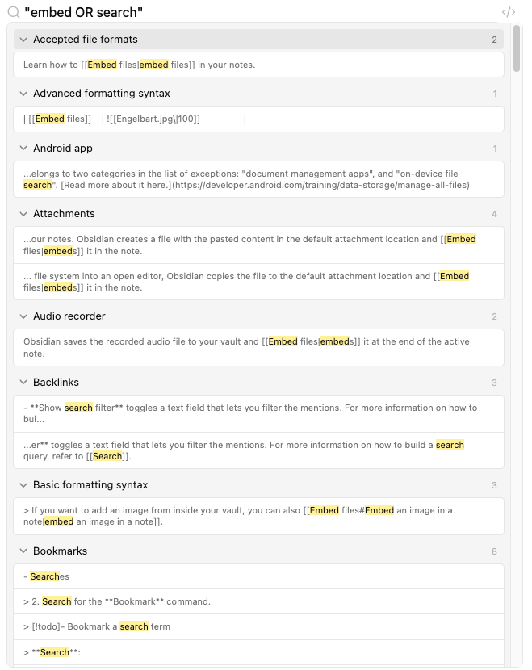

# kiln-search — 插件里的全局搜索框

## 问题

三页都只有"按属性收窄"（`kiln-issue-filter` / `kiln-timeline-filter`），没有"按记忆里的字符串找"。
仓库一大就不够用：本仓 16 条 issue、`~/kiln` 58 条，动作数 104 / 256。
典型场景是"我记得有条 issue 名字里带 graph，但想不起是哪条、属于哪个领域"——
这时要一个一个看，或者把整页滚一遍。

## 目标（这一版的最小要求）

**能按 issue 名找到 issue**：输入片段 → 列表收窄 → 命中片段可见 → 回车聚焦到那条 issue。

"要不要做成多功能搜索"**这一版不定**，留给 hypothesize 比较。候选范围：

- 只搜 issue id（最小）；
- 加上标题（issue 的 ask / 最后动作标题）与动作标题；
- 再加标签、领域、关系名（`part-of` / `blocks`…）；
- 或者学 Quick Open 的前缀语法（`#tag`、`@action`）把多功能塞进一个输入框。

## 边界

- **客户端过滤**：数据都在快照里，不加宿主路由参数、不调 `kiln list`。
- 不引第三方搜索库：模糊匹配与高亮自己写（几十行）。
- 不改现有筛选的语义；搜索与筛选是两条路，可以叠加，但不能互相顶掉。
- 不做跨页的"跳到某个动作"（要不要有，取决于多功能那条怎么定）。

## 验收（最小版）

- 输入即收窄（不按回车才搜）；没有命中时给明确空态，而不是空列表。
- 命中的片段在结果里可见（高亮）。
- 键盘能全程操作：进入搜索、上下选、回车确认、Esc 退出各一条。
- 清空输入后回到进入搜索前的视图（筛选状态、展开项不被破坏）。
- 纯函数（匹配 + 排序 + 高亮切分）可单测。

## 收集：同类工具的搜索是怎么做的

看的是三种形态：**一个输入框按前缀切模式**（VS Code Quick Open）、**就地过滤 + 分组计数**
（VS Code Search 面板）、**语法化查询 + 结果分组**（Obsidian 搜索）。外加 GitHub 的限定符写法做对照。

### 1. VS Code Quick Open：一个框，前缀决定模式


- 输入框在窗口顶部，**没有模式下拉框**：打 `>` 切命令、`@` 切符号、`#` 切工作区符号、
  `%` 直接全文搜索、`:` 跳到行号；
- 打 `?` 就地列出这张速查表——**自解释**，不用去翻文档；
- 结果行把命中的字符**加粗**（图里 `edt` 在 `edt`、`Editors` 里是粗的），右侧标出等价快捷键；
- 也就是说：**搜索框同时承担"发现功能"**，而"多功能"是靠前缀塞进去的，不是靠多个输入框。

对我们的含义：多功能搜索完全可行的形态是"一个框 + 前缀"，但必须配 `?` 这种自解释入口，
否则用户不知道有 `#tag` 这种写法。

### 2. VS Code Search 面板：就地过滤 + 计数摘要 + 按文件分组


- 输入框下方一行摘要：`10 results in 3 files` —— 先给"规模感"，再给细节；
- 结果**按文件分组**，每组右侧是命中数，组内每条是带上下文的一行，命中片段高亮；
- 大小写 / 全词 / 正则做成输入框右侧的小开关（`Aa`、`ab`、`.*`）——**高级能力收在开关里**，
  不占输入框、不要求用户先学会语法。

对我们的含义：结果要带计数；分组是天然的（issue / 动作 / 关系）；高级选项不要塞进输入语法。

### 3. Obsidian 搜索：语法化查询 + 结果分组



- 查询支持限定符：`file:`（文件名）、`path:`、`content:`、`tag:`、`line:`、`section:`、`task:`、
  `match-case:` / `ignore-case:`，还有引号短语、`OR`、`-` 取反、`/regex/`、括号嵌套
  （`task:(call OR email)`）；
- 结果按**文件**分组（可折叠），组名右侧是命中数，展开后是带高亮的片段；
- 第一层体验仍然简单：打几个字就有结果，语法是"会了更省事"的第二层。

对我们的含义：语法可以很强大，但默认体验必须"打字即搜"；语法是给熟练用户的增量。

### 4. 对照：GitHub 的限定符

`is:issue` / `is:open` / `in:title` / `label:bug` / `author:` ——同一套语法贯穿网页搜索、API 与
`gh` 命令；代价是**必须记住词表**（没有 `?` 速查，只能翻文档）。它说明"前缀语法"能表达很复杂的筛选，
但也说明：**只靠语法、不给默认路径**会把大多数用户挡在门外。

### 归纳：四条可以照搬的决定

1. **默认"打字即搜"**，不用先选模式；模式靠前缀或开关，不靠下拉框。
2. **多功能可以塞进一个框**，但要有自解释入口（`?` 速查 / 占位提示里写出几个前缀）。
3. **结果成组 + 每组带计数 + 命中高亮**；空结果给"没找到 X"而不是空白。
4. **高级选项做成开关**（大小写 / 全词 / 正则），不要求用户写对语法。

### 我们的约束（与上面四家的差别）

- **没有全屏覆盖层**：插件活在会话的侧边视图里，结果只能落在这一块区域。
  所以 Quick Open 那种"浮层 + 分组列表"要压缩成"页栏里的一条输入 + 就地过滤"。
- **数据量小**：16–58 条 issue、104–256 个动作都在内存里，不需要索引，线性扫一遍即可（毫秒级）；
  也因此**不需要引入模糊搜索库**。
- **已有三层状态**：筛选（`filters` / `rowFilters`）、焦点、展开项。搜索是**第四条**状态，
  必须定义好它与前三条的叠加关系（尤其"清空搜索后回到原样"）。
- **键盘入口**：宿主有 `ctx.shortcuts` 能力（`kiln-flow-focus-ui` 里查过："热键须走 ctx.shortcuts"），
  所以"按 `/` 或 `Ctrl+F` 进入搜索"在技术上可行，但要不要占用全局快捷键是 hypothesize 的问题。

## 候选交互（留给 hypothesize 比）

| | A 就地过滤 | B 覆盖层（Quick Open 式） | C 混合 |
| --- | --- | --- | --- |
| 输入框位置 | 页栏（与计数/筛选同层） | 浮层，覆盖内容区 | 页栏 + 跨页提示 |
| 结果呈现 | 当前页列表就地收窄 | 独立结果列表（分组） | 同页收窄；跨页命中给"去另一页" |
| 适合规模 | 小数据量（我们） | 大数据量、跨领域 | 两者之间 |
| 与筛选的关系 | 可叠加（AND） | 通常互斥（覆盖层清空筛选） | 可叠加 |
| 键盘 | 输入框内上下选 | 全局快捷键 + 输入 | 同 A |
| 风险 | 侧栏高度被输入框吃掉 | 在窄面板里做浮层很挤 | 两套逻辑容易分叉 |


## 决定：输入框放在第一层页头的中间

用户给了方向：搜索框放在 `.dkf-head`（仓库名 / 刷新那一行）的中间。据此比完三个候选：

| | A 就地过滤（**选**） | B 覆盖层 | C 混合 |
| --- | --- | --- | --- |
| 位置 | 第一层页头中间，`flex:1` | 浮层覆盖内容 | 页头 + 跨页跳转 |
| 为什么不选 | — | 侧栏宽度下浮层比内容区还挤，且要自己管焦点陷阱 | 两套呈现逻辑必然分叉 |
| 结果 | 有输入时内容区换成结果列表 | 同左 | 同左 |
| 与筛选 | 搜索期间忽略筛选（见下） | 互斥 | — |

**"就地过滤"在这里的准确含义**：输入框常驻页头，**一旦有输入，内容区整体换成结果列表**；
不是把当前页的列表收窄（那样搜不到别的页里的东西，和"全局"矛盾）。

### 页头几何

```text
┌──────────────────────────────────────────────────────────────┐
│ dsh-kiln   [ 搜索 issue…            ]   焦点：x ×     刷新  │  34px
└──────────────────────────────────────────────────────────────┘
             └─ flex:1 1 160px，max-width 360px ─┘
```

- 输入框占掉原来的 `.dkf-spacer` 位置（repo 与焦点 chip 之间），高度 22px（与刷新、chip 同档），
  圆角 `--dkf-r`，底色 `--dkf-bg2`，`.5px` 内描边 `--dkf-line`；聚焦时描边换 `--dkf-accent`（2px 内环，与全站一致）；
- 仓库名让位：`flex:0 1 auto; max-width:180px`（超长省略，提示里已有全路径）；
- 焦点 chip 保持 `max-width:320px` 但可被压缩（`flex:0 1 auto`），窄宽度下先缩它，不缩输入框；
- 搜索期间**页签与筛选条仍在原位**（点页签＝清空搜索并离开，见状态表），避免布局跳动。

### 搜什么：这一版只搜 issue

| 方案 | 内容 | 判定 |
| --- | --- | --- |
| M1（**选**） | issue id + issue 标题（ask / 最后动作标题） | 最小要求已满足；结果结构按"分组"设计，天然留给 M2 |
| M2 | 再加动作标题（选中要跳到时间线并展开那条提交） | 需要跨页状态编排（tab + expanded + 滚动定位），价值还没验证 |
| M3 | 前缀语法（`#tag` / `@action`） | 词表只有 6 个动作 + 少量标签，语法的学习成本大于收益 |

M2/M3 的触发条件写在这：**等动作级标签进 `path --json`**（见 `~/kiln` 的 `path-action-tags`）、
或者"在时间线里找某条提交"变成高频动作时，再把结果分组扩到动作。

### 匹配与排序（纯函数，可单测）

- **切词**：按空格切成多个 term，**全部命中才算命中**（AND）；大小写不敏感；中文按原文匹配；
- **字段**：`id` 与 `title` 分开算，命中位置用于高亮；
- **排序**：`id` 前缀命中 > `id` 子串命中 > `title` 命中 > 仅标题末命中；同档按最近动作时间倒序（与 issue 页一致）；
- **不做的**：模糊子序列（`kdsh` 匹配 `kiln-dsh-*`）。数据量小，子序列会带来大量意外命中，
  收益不如"前缀优先"的排序。

### 结果视图

- 顶部一行摘要：`8 条命中 · 仓库共 16 条`（与 VS Code 的 `10 results in 3 files` 同思路：先给规模）；
- 行 = `[id（mono，高亮）] [title（高亮）] [domain chip] [状态 chip]`，右侧 `⏎ 聚焦`；
- 空结果：`没有找到「xxx」` + 一行提示"试试更短的关键词，或按 Esc 清空"；
- 选中一行 → 聚焦该 issue + 切到 issue 页 + 清空输入（回到进入搜索前的视图）。
  与列表里点行的行为一致（`⌖ 聚焦` 走同一条 `focusIssue`）。

### 状态与键盘

| 事件 | 行为 |
| --- | --- |
| 输入 | 立即计算（数据在内存，无需 debounce） |
| `↓` / `↑` | 在结果里移动选中（输入框保持焦点） |
| `⏎` | 确认选中行（IME 组合中不触发，见风险） |
| `Esc` | 第一次清空输入；输入已空时退出搜索（回到原页） |
| 点击页签 / 打开筛选 | 清空输入并离开搜索 |
| 清空输入 | 内容区回到当前页（页签、筛选、展开项原样） |

- **搜索期间忽略筛选与焦点作用域**：搜索是"直接找那一条"，被筛选悄悄过滤掉最糟；
  要收窄可以搜完再筛。摘要里的"仓库共 N 条"就是用来表明这是全仓范围。
- **不做全局快捷键**（v1）：`ctx.shortcuts` 能绑，但与宿主的 `Ctrl+F` / `/` 语义冲突风险大；
  先用"点输入框"这一条路，等有人抱怨再说。

### 风险与边界

- **窄宽度**：页头四件套（repo / 搜索 / 焦点 chip / 刷新）在 400px 以下会挤。
  缓解：repo 与 chip 都可省略号，输入框 `min-width:96px` 保底；实在放不下时输入框换到第二行（后续）。
- **IME**：中文输入时 `Enter` 是"上屏"不是"确认"。必须监听 `compositionstart` / `compositionend`，
  组合期间不处理 `Enter` 与 `↑↓`。
- **输入框抢键**：搜索框获得焦点时，列表的方向键处理器必须让路（现在的 `listKeyDown` 挂在列表上，
  只要不在列表内触发就不会冲突，但 `Esc` 要按"输入框优先"处理）。
- **不落盘**：查询串只在内存里，切页/卸载即清空（不进 `VIEW_STATE`）。
## 落地

1. **纯函数**（`client.js`，可单测）：
   - `splitTerms(query)`：按空白切词、小写、去空；
   - `mergeRanges(ranges)` / `matchRanges(text, terms)`：算出所有命中区间并合并相邻段，供高亮切分；
   - `searchIssues(issues, query)`：AND 匹配（词可分别落在 id 或标题）、四档排序
     （id 前缀 > id 命中 > 标题命中 > 拆开命中）＋同档按最近动作时间。
2. **组件** `SearchResults`：`[id 高亮] [标题高亮] [领域] [状态] [⏎]`；空结果显示
   「没有找到「xxx」」＋“试试更短的关键词，或按 Esc 清空”。
3. **输入框**进第一层页头（替掉原来的弹性空白）：`flex:1 1 160px; min-width:96px; max-width:360px`，
   22px 高、`bg-layer-2` 底、`.5px` 内描边，聚焦换 2px accent 内环；仓库名收到 `max-width:180px`。
4. **状态**：`query` / `searchIndex` 只活在本次挂载（不进 `VIEW_STATE`）；有输入时内容区换成结果，
   页栏右侧显示 `N 条命中 · 仓库共 M 条`，筛选条让位。
5. **键盘**：`↓/↑` 在结果里移动（焦点留在输入框，选中行用 `.dkf-hit-on`）；
   `⏎` 确认（未选中时取第一条）→ 聚焦 + 切到 issue 页 + 清空；`Esc` 先清空、再失焦。
6. **IME**：`compositionstart/end` 期间不处理 `⏎` 与方向键——中文输入时回车是“上屏”。

### 与 hypothesize 的偏差（小）

- 搜索期间**筛选条隐藏**（原稿写"仍在原位"）：结果已整块换掉，留着筛选条会让人以为筛选仍作用于结果；
  点页签仍是"离开搜索"，这条没变。
- 摘要文案用 `N 条命中 · 仓库共 M 条`（原稿 `N 条命中 · 仓库共 16 条` 的示例值换成实际总数）。

### 验证

- `npm test --prefix plugin` → 43 个宿主用例 + 40 个渲染用例全过。新增四条：
  - 单测：切词/大小写、`matchRanges` 的相邻合并、AND、排序（id 命中在前）、空查询；
  - 渲染：输入框在 `.dkf-head` 内（不是另起一行）、有输入时换成结果列表且页栏写「1 条命中 · 仓库共 3 条」、
    命中片段有 `.dkf-hl`、没命中时文案含「没有找到「zzz」」与 Esc 提示。
- 静态：CSS 仍无裸 hex；`.dkf-spacer` 已删（它被输入框取代）。

### 已知边界

- **没有全局快捷键**：要搜就点输入框（`ctx.shortcuts` 能绑，但与宿主 `Ctrl+F` / `/` 冲突风险大）。
- **只搜 issue 的 id 与标题**：动作、标签、领域都还没进搜索（M2/M3 的触发条件写在上面）。
- **不做模糊子序列**：`kdsh` 不会命中 `kiln-dsh-*`。数据量小，收益不如可预测的前缀排序。
- **窄宽度**：页头四件套在 400px 以下会挤；缓解是 repo/chip 省略号 + 输入框 96px 保底，
  再窄就得把输入框挪到第二行（未做）。
- **没实拍**：沙箱起不了 Chromium，需重启桌面应用肉眼验收（重点看：输入是否即时、焦点行高亮、
  窄侧栏下四件套是否挤）。