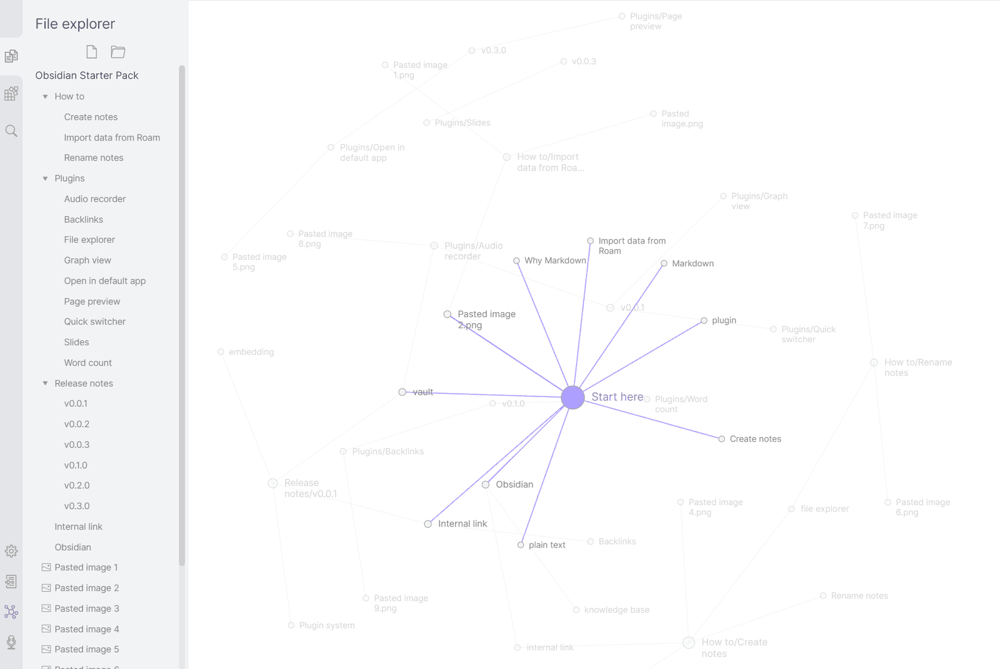
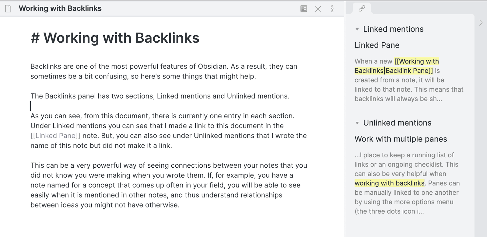
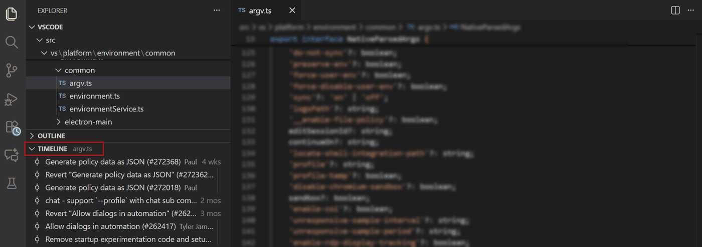
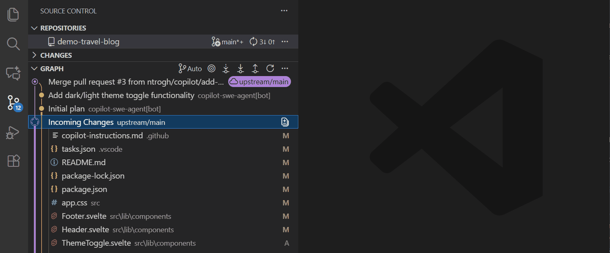
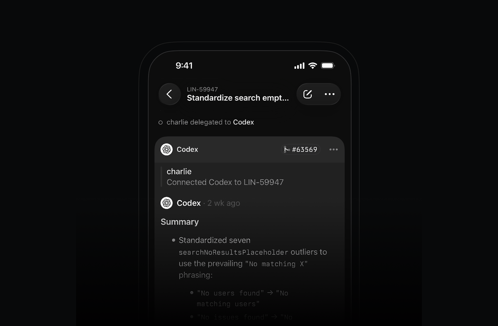

# kiln-ui-refresh — 三页视觉语言统一 + 重做外观

## 问题

三个页面（时间线 / issue / 关系）功能上已经闭环，视觉却是逐次长出来的：时间线来自
`kiln-flow-focus-ui`，关系图来自 `kiln-relation-graph`，聚焦结构来自 `kiln-issue-focus-page`，
节点提示来自 `kiln-node-hover`。每个 issue 只对"当下那一页"负责，没有人为"三页并排看"做过一次决定。
结果是：观感像三个插件，而不是一个视图的三个面。

可以在 `plugin/lib/client.js` 的 CSS 里数出来的症状：

- **字号自己一套**：手写 10 / 11 / 12 / 13px 五档。宿主有八档语义字号
  （11 / 12 / 13 / 14 / 16 / 18 / 20 / 24），最小的一档是 11px，我们用了它没有的 10px。
- **圆角六种**：2 / 3 / 4 / 6 / 10px。宿主有 `xs 4 / sm 8 / md 12 / lg 16 / xl / panel 28` 六档，
  一对一对不上，卡片（6）、胶囊（10）、标签（3）互相之间也没有可推的规律。
- **三种行网格各写各的**：issue 行 7 列、action 行 7 列、子行 5 列，`grid-template-columns`
  三段独立字符串；同一个"issue id"列在三页的 x 位置不同，扫视时眼睛要重排。
- **选中态两套**：页面 tab 用 2px 下划线（`inset 0 -2px 0`），分段按钮用浅底
  （`interactive-bg-hover`，而且两处透明度不一致：`.04` 与 `.06`）。
- **hover 底色硬编码** 9 处 `rgba(0,0,0,.04)`；深色模式下语法上仍能靠 token 生效，
  但 .06 那处是叠加色，深色下会发灰。
- **代码字体 token 写错**：CSS 里 11 处 `var(--dsw-font-family-code,monospace)`，
  宿主全部包内 **0 处**定义这个名字（正确的叫 `--ds-font-family-code`）。后果是这些代码文本
  永远落在 `monospace`，用户在设置里换代码字体对这三页无效。
- **颜色靠硬编码兜底**：`#111` 出现 17 次、`#666` 14 次、`#999` 11 次、`#e3e3e3` 9 次。
  token 存在时兜底不生效，但 `#b4690e`（warn）和 `#35a35f`（完成态）是裸色，
  在深色主题里没有对应台阶，和宿主其它面板不是一个色阶。
- **间距不是网格**：`padding` 有 `5px 6px / 4px 6px / 2px 4px / 1px 8px / 6px 9px / 10px 14px 32px`，
  `gap` 有 2 / 4 / 6 / 8，没有一条能一眼推出的规律。

还有一层结构性问题：宿主本来就有一条视图 tab 条（对话 / 轨迹 / 上下文 …），我们注册一个
`kiln` 视图后在它正下方又画了一条 `.dkf-tabs`——两条 tab 叠着，层级重复，而且我们这条的
选中样式和宿主那条不一样。

## 目标

1. **一套几何**：字号、行高、间距、圆角只用宿主有的台阶，三页共用同一组值。
2. **一套颜色角色**：文本三级 / 边框两级 / 背景两级 / 交互底色 / 状态色，全部走 `--dsw-*`；
   action 六色是数据语义（不必是宿主色），但集中定义一次、派生色也用变量。
3. **一套行语法**：序号、动作条、issue id、标题、时间在同一批 x 位置上；同类行行高一致。
4. **一套页头**：标题 + 计数 + 工具的位置三页相同；空态 / 错误态 / 加载态共用一套排版。
5. **重做外观**：拉开信息层级（标题 > 元信息 > 细节），图的外框、工具条、图例与页面其余部分同材质。

## 边界

- 只改客户端呈现：DOM 结构与 CSS。宿主代码不动，不引新依赖，不加构建步骤。
- 交互模型不变（点行展开、行尾聚焦、Esc 退出、图上 hover / 拖动语义）。这是重做外观，不是重做交互。
- 只读约束不变：数据仍只来自 `/kiln/flow`。
- 关系图的线型阶梯（part-of 3.4px → relates-to 2 5 虚线）已被 `kiln-graph-label-threshold` 定过，
  不改语义，只允许改画在什么底色上、图例怎么排。

## 验收

- 字号不再出现 10px 与 13px 之外的手写档；全部来自一组定义在 `.dkf-root` 上的局部变量，
  变量值本身引用宿主 `--dsw-font-*` 台阶。
- 圆角只用 3 档（4 / 8 / 12），全部引用 `--dsw-radius-*`。
- 文本 / 边框 / 背景 / 交互色 0 处裸 hex（action 语义色除外，且只在一处定义）。
- `--dsw-font-family-code` 全部换成 `--ds-font-family-code`。
- 三页的行列定义收敛成一份常量，同名列 x 对齐。
- 一致性自查表（见下）逐条通过，并留下三页截图作对照。

## 收集：同类工具怎么设计

选样标准：只收「以只读身份嵌进一个宿主应用」的图 / 列表视图，而不是独立 Web 应用——
我们受制于宿主的字号台阶、面板宽度与主题，独立 app 的排版自由我们用不上。

### 1. 聚焦图 — Obsidian 的局部图



- 焦点是**唯一**的实心大圆，其余节点退成描边小圆 + 灰色标签；
- 焦点到邻居的边是紫色实线，非邻域的边不是隐藏，而是淡到几乎看不见——保留"还有别的结构"的信号；
- 标签直接写在节点旁边，没有框、没有底板；节点密的地方让位而不是压暗；
- 图占满内容区，设置/文件树在侧栏，图不跟列表争空间。

对照我们：聚焦视图现在是「圈外淡化 + 焦点蓝色 glow」。glow 是**第二个**视觉系统（颜色 + 阴影），
而 Obsidian 只用"实心 vs 描边 + 边着色"就分出了主次。

### 2. 结构化关系 — Obsidian 的 Backlinks 面板



- 分组标题是可折叠的一行，字号比条目大一号，前面一个三角；
- 条目 = **来源标题 + 上下文片段**（片段里把命中的词高亮），条目之间不画分割线，靠留白分组；
- 整个面板是右栏一块浅底区域，与正文只靠底色差分开，没有边框。

对照我们：issue 页的聚焦结构是「`→` `←` + 关系名 + 标题」，回答"是什么关系"，
不回答"凭什么说它们有关系"。片段/证据这件事我们其实有（action 标题），只是没摆出来。

### 3. 事件流 — VS Code 的 TIMELINE 视图



- 一条竖轨，每个事件一个空心点，点与点之间只有竖线；
- 行内三样：标题（常规字重）、相对时间、作者，全部同一字号，只有颜色分主次；
- 行高紧凑（约 22px），没有卡片、没有分割线、没有斑马纹。

对照我们：时间线一行里塞了动作色条 + 序号 + issue id + 动作名 + 标题 + 时间 + 短 sha 七样，
比它密一档；密集不是问题，问题是七样东西**字重、颜色、字号全一样**，扫视没有抓手。

### 4. 图与行混排 — VS Code 的 Source Control Graph



- 每一行左边是"轨道 + 节点"，节点颜色区分分支——图例不是单独一块，而是**每行自带**的语义；
- 引用（`upstream/main`）画成胶囊：强调色 10% 底 + 强调色文字 + 云图标；
- 区块标题（`GRAPH`）大写小字，右侧一排图标按钮，按钮默认无边框，hover 才有底；
- 选中行是整行底色高亮，不是描边。

对照我们：关系页现在是「图 + 图例网格 + 提示框」三套讲法。图例占掉一整块，
而它讲的东西（线型 ↔ 关系）在聚焦视图里其实已经由行上的关系名讲过一遍了。

### 5. 页面骨架 — Linear 的 2026-03 UI refresh



来源：<https://linear.app/changelog/2026-03-12-ui-refresh>。原文列的三条正是我们要做的：
header、导航与视图控件在各处保持一致；图标统一重绘并统一尺寸；侧栏比内容区更暗，让内容区浮起来。

图上可读到的排版决定：issue id 用次级色小字放在标题上方（不是同行）；标题一行 600 字重；
引用块用左侧 2px 竖线（没有底色）；卡片圆角 ≥ 16px、内边距 ≥ 16px。

### 归纳：五个可以直接照搬的决定

1. **主次只用一个维度**：焦点靠"实心 vs 描边 + 边着色"，不用 glow。
2. **分组靠留白与字号，不靠线和框**：标题大一号、条目无边框。
3. **每行自带语义**，不要独立的图例块。
4. **一条竖轨**做时间与层级的公共骨架（时间线、聚焦结构都能用）。
5. **先统一骨架再谈装饰**：标题 / 计数 / 工具三件套位置固定，装饰（圆角、底色）才有意义。

## 收集：宿主的设计系统（这是"统一"的判据）

`@deepseek-ai/dsh-client-ui-theme` 的 README 写明「token 样式表是颜色值的唯一权威来源：设计系统中
缺失的值会有意不补入；一律采用最接近的语义 token」。从它的 `lib/client.js` 里数出来：

| 类别 | 宿主提供 |
| --- | --- |
| 变量总数 | 414 个 `--dsw-*` / `--dsh-*` 定义 |
| 字号台阶 | `xxxs 11 / xxs 12 / xs 13 / s 14 / base 16 / m 18 / l 20 / xl 24`，每档带 family / weight / line-height |
| 圆角 | `--dsw-radius-xs/sm/md/lg/panel` = 4 / 8 / 12 / 16 / 28 |
| 背景 | `bg-layer-1/2/3`、`bg-base`、`bg-overlay`、`bg-skeleton` |
| 文本 | `label-primary / secondary / tertiary / dimmed / caption / inverted` |
| 边框 | `border-l1..l4`（l2 = `#0000001a`），另有 `border-thin` |
| 交互 | `interactive-bg-hover` = `#2631480f` |
| 状态 | `state-business-primary` = `--dsw-static-deepseek-500` 等 |
| 浮层 | `elevation-panel / prominent / soft`、`shadow-lv1..3` |
| 代码字体 | **`--ds-font-family-code`**（= `--dsh-font-family-code-default` 的别名） |

两条硬事实，直接决定能不能"像宿主"：

- 宿主 8 档字号不是死常量：设置里的正文字号步进器改 `--dsh-content-font-size`，台阶跟着缩放。
  我们手写 `font:12px/18px` 就是彻底脱离这套缩放。
- 宿主样式是 CSS Modules 哈希类名（`Dc7zOa_*` 这种），**不能复用**。能对齐的只有 token 与几何
  （字号 / 行高 / 圆角 / 底色 / 边框），这也正是本 issue 的范围。

## 收集：现状测量

都在 `plugin/lib/client.js` 的 `CSS` 模板串里（103 行 / 93 条规则 / 339 条声明）：

| 项 | 现状 | 宿主对应 |
| --- | --- | --- |
| 字号 | 手写 10 / 11 / 12 / 13px 五档，字重 400 / 500 / 600 | 8 档台阶，最小 11px |
| 圆角 | 2 / 3 / 4 / 6 / 10px 六种 | 4 / 8 / 12 / 16 / 28 |
| `gap` | 2 / 4 / 6 / 8 | 无间距 token |
| 行网格 | issue 行 7 列、action 行 7 列、子行 5 列，三份独立的 `grid-template-columns` | — |
| `var()` 声明 | 111 / 339 | — |
| 裸 hex 声明 | 2（`#b4690e` 警告、`#35a35f` 完成） | 状态色 token |
| hex 兜底 | 13 个不同值：`#111`×17、`#666`×14、`#999`×11、`#e3e3e3`×9、`#fff`×4… | label / border 梯队 |
| `rgba()` | 11 处（hover 底 `.04`×9、`.06`×1、tooltip 阴影 1） | `interactive-bg-hover` |
| 代码字体 | `--dsw-font-family-code`×11 —— 宿主 **0 处**定义 | `--ds-font-family-code` |

附带一个可复现的结论：`Get-ChildItem … | Select-String 'dsw-font-family-code'` 在
`@deepseek-ai` 全部包内 0 命中，`dsh-font-family-code` 2 个文件命中（定义处 + 引导脚本）。
即"改代码字体设对这三页无效"是可验证的事实，不是推测。

## 一致性自查表（apply 时逐条过）

1. 三页的页面标题行在同一 y 位置，字体与字号相同。
2. 同一列（issue id / 标题 / 时间）在三页的 x 位置相同（同一份列定义）。
3. 页面上出现的每一种字号都能在宿主台阶里找到（11 / 12 / 13 / 14 之一，或 mono 11 / 12）。
4. 页面上出现的每一种圆角都能在 `--dsw-radius-*` 里找到。
5. 文本 / 边框 / 背景 0 处裸 hex；action 六色集中定义一次。
6. hover / 选中 / 聚焦三种状态在三页用同一套表达（底色 or 阴影，不混用）。
7. 空态、错误态、加载态三页共用一套排版（标题 + 说明 + 可选动作）。
8. 深色主题下不出现"硬编码浅色底"或"看不见的边框"。

### 参考图来源

五张都是截屏，仅作排版参考，不随仓库分发许可证；上游地址：

- `ref-obsidian-local-graph.png` / `ref-obsidian-relations-panel.png` —
  <https://github.com/obsidianmd/obsidian-help>（`en/Attachments/obsidian-graph-view.png`、
  `en/Attachments/Backlinks.png`），对应帮助页面「Graph view」「Backlinks」；
- `ref-vscode-timeline.png` / `ref-vscode-scm-graph.png` —
  <https://code.visualstudio.com/docs/sourcecontrol/history>；
- `ref-linear-issue-view.png` — <https://linear.app/changelog/2026-03-12-ui-refresh>。

## 方案比较

三条路，差别在"动到哪一层"。

| | A 只换值 | **B 换骨架（选它）** | C 注册三个视图 |
| --- | --- | --- | --- |
| 改什么 | CSS 里的字号/圆角/颜色换成宿主台阶 | A + 重排页头与行语法 + 图去图例化 | B + 拆成三个 `conversation.view`，用宿主的 tab 条 |
| 结构风险 | 无 | 中：DOM 包装层变化，测试要跟着改 | 高：注册方式、焦点共享、宿主 tab 条挤 6 个 |
| 能解决"像三个插件"吗 | 部分——颜色统一了，骨架还是各写各的 | 是 | 是，但代价不在这一版 |
| 可回滚 | 一个提交 | 一个提交（CSS + 少量 JSX） | 要回滚注册方式 |

选 **B**：A 治不好行网格三份的问题，C 会改动注册与导航语义（还要在宿主的 tab 条上再挤三个），
不该混进"重做外观"。C 单独记一条后续 issue。

## 方案 B 的规格

### 骨架：两层页头，三页共用

```
┌──────────────────────────────────────────────────────────┐
│ dsh-kiln                                  焦点：x ×  刷新 │  ← .dkf-head（32px）
├──────────────────────────────────────────────────────────┤
│ ( 时间线 │ issue │ 关系 )                    11 issue     │  ← .dkf-bar（34px）
├──────────────────────────────────────────────────────────┤
│                                                          │
│  页面内容（唯一可滚动区）                                  │
└──────────────────────────────────────────────────────────┘
```

- 第一层只放"这是哪个仓库"和全局动作（焦点、刷新）；
- 第二层左边是页切换，右边是**当前页的计数或工具**：时间线页放动作数，issue 页放 issue 数，
  关系页放三段图的取景控件。这样三页的第二层**永远存在、同高、内容对齐**，
  不会出现"只在关系页多一行工具"的割裂。
- 去掉 `.dkf-head` 里重复的 `kiln` 字样（宿主 tab 已经是 kiln），仓库名填补左侧。

### 几何：全部走宿主台阶

| 语义 | 值 | 来源 |
| --- | --- | --- |
| 元信息（时间、sha、计数） | 11px / 16px | `--dsw-font-xxxs-11-*` |
| 正文（标题、行文本、按钮） | 12px / 18px | `--dsw-font-xxs-12-*` |
| 强调（页头仓库名、焦点 chip） | 13px / 20px，600 | `--dsw-font-xs-13-*` |
| 代码（issue id、sha、token） | 11px / 16px `--ds-font-family-code` | 宿主代码字体别名 |
| 圆角：行 / 控件 | 4px | `--dsw-radius-xs` |
| 圆角：容器（图框、工具组） | 8px | `--dsw-radius-sm` |
| 圆角：浮层（tooltip） | 12px | `--dsw-radius-md` |
| 行内间距 | 2 的倍数：2 / 4 / 6 / 8 / 12 | — |
| 区块间距 | 12 / 16 | — |

### 颜色角色：8 个变量，其余派生

```css
--dkf-fg    label-primary        --dkf-line        border-l2
--dkf-fg2   label-secondary      --dkf-line-strong border-l3
--dkf-fg3   label-tertiary       --dkf-bg          bg-layer-1
--dkf-hover interactive-bg-hover --dkf-bg2         bg-layer-2
--dkf-accent state-business-primary   --dkf-mono   --ds-font-family-code
```

action 六色保留为数据语义，但**从 JS 内联色改成每行一个 CSS 变量**（`--dkf-row-color`），
由 CSS 决定它出现在哪（时间线的点、动作名、详情里的色条），不再三处各写一遍。

### 行语法：一份列定义

三页的行共用同一批列（x 位置一致）：

| 列 | 宽 | 内容 |
| --- | --- | --- |
| 标记 | 12px | 时间线：动作色点；issue：展开箭头；关系结构：关系方向符 |
| 身份 | 自动（≤22ch） | issue id（mono 11，primary） |
| 动作/关系 | 自动 | 动作名（色）或关系名（tertiary） |
| 主体 | 1fr | 标题（12px，primary），单行省略 |
| 右侧元信息 | 自动 | 时间 / 动作数（11px，tertiary） |

时间线额外获得一条**竖脊**（`.dkf-list` 上一条 1px 竖线，色点压在线上），
这是从 VS Code TIMELINE 借的唯一"装饰"，它同时给了"有序"的暗示，比每行一条色带省。

### 状态：三种状态，一套表达

| 状态 | 表达 |
| --- | --- |
| hover | 底色 `--dkf-hover`（所有可点元素一致，含行、页签、图标按钮） |
| 选中 / 当前 | 底色 `--dkf-bg2` + 文字 primary + 600 字重（页签、焦点行） |
| 键盘焦点 | `inset 0 0 0 2px var(--dkf-accent)`（与宿主 `--dsw-focus-ring-width` 同宽） |

不再出现"下划线选中"和"浅底选中"两种写法。

### 关系图：去图例化

- 图框：`bg-layer-2` + 1px 内描边 + 8px 圆角，去掉外边框（避免和内容区边界打架）；
- 图例：从"网格块"压成**一行可换行的条目**，每条 = 线段样例 + 「A 动词 B」，
  11px tertiary；它只解释线型，不再重复解释关系名（关系名在 issue 页的行上已经有了）；
- tooltip：圆角 12、`--dsw-shadow-lv2`、内边距 8/10、max-width 320，标题 12/18、元信息 11/16。

### 三页各自的具体改动

- **时间线**：竖脊 + 色点；去掉行内 3px 色条；动作名保色、去掉边框胶囊（胶囊只留给"完成/状态"）。
- **issue（无焦点）**：行高从 5px padding 收到 4px，计数与时间统一到右列；焦点按钮只在 hover 出现（不变）。
- **issue（聚焦）**：分组标题改 11px/600/tertiary（去掉 uppercase 与 letter-spacing 的英文习惯），
  关系行改成"方向符 + 关系名 + id + 标题"，与无焦点行同列。
- **关系**：只留图；取景控件上移到第二层页头。

### 风险与代价

- **宿主 token 改名/消失**：全部 `var(--x, 兜底)` 两段式，兜底用中性灰；失效时只是回到今天的观感，不会崩。
- **深色主题无法在本地验证**：只能靠"零裸色 + 只用语义 token"来保证，验收是静态检查而非截图。
- **测试跟改**：保留 `dkf-tab` / `dkf-modebtn` / `dkf-arow` / `dkf-row` / `dkf-legend-*` 这些类名，
  只加不改名，`render.mjs` 的查询仍有效；新增的 `.dkf-bar` 需要补一条断言。
- **图在重绘后丢注入**：`paintFocus` 的既有约束不变，lineStyle 仍走 mermaid `linkStyle`。

### 不做

- 不改交互（点行展开、行尾聚焦、Esc、图上 hover/拖动）。
- 不动线型阶梯与其语义（`kiln-graph-label-threshold` 定的）。
- 不引入图标库（宿主图标拿不到，自己画的 SVG 只在必要处用：展开箭头、关系方向符）。
- 不拆三个视图（C，后续 issue）。

## 落地

改动三处：`plugin/lib/client.js`（CSS 块 + 页头/页栏 + ActionRow / ActionLines / TimelinePanel）、
`plugin/test/render.mjs`（+4 条结构断言）、`plugin/README.md`（外观一段）。

### 数字对照（同一段 CSS，改前 → 改后）

| 项 | 改前 | 改后 |
| --- | --- | --- |
| CSS 行数 / 规则数 | 103 / 93 | 142 / 95 |
| 声明总数 | 339 | 442 |
| 走 `var()` 的声明 | 111 | 192 |
| 裸 hex 声明（不包 var） | 2 | **0** |
| `rgba()` 直写 | 11 | 0（只剩浮层阴影的 var 兜底） |
| 手写 `px` 值 | 202 个 / 29 种 | 134 个 / 28 种 |
| 字号 | 10 / 11 / 12 / 13px（+ `font` 简写 11 种组合） | 11 / 12 / 13px，全部走局部变量，0 处 `font` 简写 |
| 圆角 | 2 / 3 / 4 / 6 / 10px | `--dsw-radius-xs/sm/md`（4 / 8 / 12）+ 1px 色条 + 50% 色点 |
| 代码字体 | `--dsw-font-family-code`（宿主无此名） | `--ds-font-family-code` |
| 引用的宿主 token | 12 个（含 1 个不存在的） | 16 个（全部存在） |

### 落地了什么

1. **两层页头**：`.dkf-head` 只有仓库名（12/600）与全局动作（焦点 chip、刷新，都是无边框 ghost 按钮）；
   `.dkf-bar` 左侧是页切换，右侧是当前页的计数（`4 个动作` / `3 个 issue`）或关系页的三段取景控件。
   三页的第二层同结构、同高、内容右对齐；关系页不再单独多一行工具条（`RelationPanel` 已删，
   取景控件上提到页栏）。
2. **行语法**：三页共用「标记 / 身份 / 动作或关系 / 主体 / 右侧元信息」五段列，
   时间线用 12px 标记列 + `.dkf-rail` 竖脊（`::before` 一条 1px 线），色点压在线中心；
   issue 行保留动作条与展开箭头，行高与时间线同档（4px 内边距）。
3. **状态一套**：hover 一律 `--dkf-hover`；选中一律 `bg-layer-2` + 600 字重 + `.5px` 内描边
   （页签、页栏控件、焦点行三处同款）；键盘焦点一律 2px `--dkf-accent` 内环。
4. **动作色只在一个地方给**：JS 不再往色点、动作名、状态标签上写内联 `background` / `color`，
   而是每行给一个 `--dkf-row-color`，CSS 决定它出现在哪里（点、动作名、标签）。
   唯一例外是 issue 行前的 12 格动作条——每一格颜色不同，只能逐格给。
5. **图**：框体改成 `bg-layer-2` + 0.5px 内描边 + 8px 圆角（去掉外边框）；图例从网格块压成一行；
   tooltip 改用宿主浮层阴影 `--dsw-elevation-panel`，圆角 12、内边距 8/10。
6. **token 修正**：`--dsw-font-family-code`（11 处）全部换成 `--ds-font-family-code`，
   代码文本终于跟随设置里的代码字体。

### 与规格的偏差（有意）

- 页栏允许 `flex-wrap`：窄宽度下关系页的三段控件会折到第二行，而不是溢出。
  正常宽度（≥ 560px）下三页都是单行 36px。
- 图的焦点标记仍用 accent 光晕，没有改成描边：mermaid 节点内部形状不可寻址（node 是 `<g>`，
  内部是 `rect`/`circle`/`polygon` 混合），改描边要重写 `paintFocus` 的选择器，属于另一个 issue。
  这里只保证"只用一种强调手段"——光晕是 accent 单色，不再叠加背景块。
- issue 行保留了 12 格的动作条（`strip()`）：它是"这个 issue 被推进过几次"的唯一视觉线索，
  删掉会丢信息，所以只压小（3×11px、55% 不透明度），当前一格用底色环标出。

### 验证

- `npm test --prefix plugin` → 31 个宿主用例 + 31 个渲染用例全过。新增 4 条结构断言：
  两层层头存在、时间线页右侧是动作数、关系页右侧是取景控件且没有计数、时间线列表带 `dkf-rail`、
  行把动作色放进 `--dkf-row-color`（不再内联）。
- `node --check plugin/lib/client.js` 通过。
- 静态审计（同一段 CSS）：裸 hex 0、`rgba()` 直写 0、`font` 简写 0、`--dsw-font-family-code` 0。

**没验证到的**：真实渲染。这台机器的沙箱禁掉 Chromium 的多进程管道（`mojo … 拒绝访问`），
Edge headless 连 `--dump-dom` 都跑不起来，截图这条路走不通；深色主题也只能靠"零裸色 + 只用语义
token"保证，没法实拍。需要重启桌面应用后肉眼过一遍：页栏在窄侧栏下的折行、深色下 bg-layer-2
与 layer-1 的对比是否够、竖脊会不会被行 hover 底色吃掉。

## 落地 2：hover 统一

改之前 CSS 里有 11 条 hover 规则、各写各的：9 条各自 `background:var(--dkf-hover)`，
1 条只改 opacity（行尾按钮的揭示），还有一条是 `.dkf-focus:hover{background:var(--dkf-bg2)}`
——焦点行本来就铺着 bg2，这条等于**没有反馈**，全表唯一"指上去不动"的行。

### 一条说法

| | 规则 |
| --- | --- |
| 叠底 | `background-image:linear-gradient(var(--dkf-hover),var(--dkf-hover))`，一条规则覆盖 11 个可交互元素 |
| 为什么用背景图 | 它**不覆盖**已有底色：焦点行铺了 bg-layer-2 也能叠上一层，焦点态与 hover 态同时可见 |
| 文字 | 可点控件（刷新 / 焦点 chip / 页签 / 取景按钮 / 面包屑 / 折叠 / 行尾聚焦）hover 时提到 primary；行不动（标题本来就是 primary） |
| 过渡 | 不做。这类即时反馈在宿主里也是直接切；`.12s` 只留给淡化与焦点那种状态变化 |

### 图里的同义句

列表能叠底色，SVG 里不能（叠出来是脏的）。所以图的 hover 说的是同一句话——
**指到谁，谁就恢复可读**：`.dkf-gnode-dim:hover{opacity:1}`，鼠标移开自动退回，不需要 JS，
也不会跟焦点的光晕抢。顺带给 `.pele-node` 加了 `cursor:pointer`（它本来就是可点的）。

### 顺带修掉的两个 hover 瑕疵

| | 问题 | 改法 |
| --- | --- | --- |
| 时间线色点 | 用 `box-shadow:0 0 0 2px var(--dkf-bg)` 打了个"底色光圈"，hover 时行底变了、光圈没变，留下一圈亮边 | 去掉光圈，线直接连到点（VS Code TIMELINE 就是这么画的） |
| issue 行动作条 | 最后一格同样用底色环标记 | 改成加高（11→13px）+ 不透明，不用底色环 |

### 验证（第二轮）

- `npm test --prefix plugin` → 37 + 31 全过。新增两条：
  叠底公式在 CSS 里只出现一次且 11 个选择器都在里面、CSS 里不再有
  `background:var(--dkf-hover)` / `.dkf-focus:hover{background:var(--dkf-bg2)}`；
  以及图上的 `dkf-gnode-dim:hover` 与 `cursor:pointer`。
- 仍然没法实拍（同前）。重启后重点看三处：焦点行 hover 有没有反应、鼠标扫过淡化节点时它是否亮起来、
  时间线色点周围还有没有那圈亮边。


